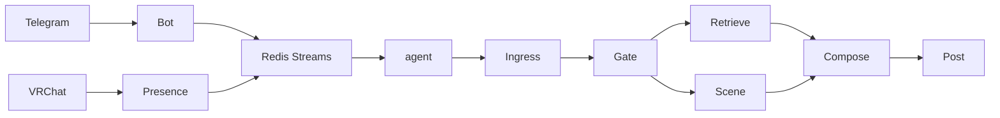

# Architecture

How VanessaAI turns a message into a reply — or silence. The
landing summary is in the [README](../README.md); this page is the
pipeline, vault, mood metrics, and the retrieve stage.

Telegram is the default adapter. VRChat is a second adapter
(`services/presence`) of the same agent — a host process on the game
PC, not a fifth server container. Do not add it to server
`docker-compose`. Redis from that PC must reach the broker
(`BROKER_REDIS_URL` is not the container's `127.0.0.1` if the PC is
elsewhere). VRChat OSC Enable, UDP `9000`; VB-Cable/VoiceMeeter into
the VRChat mic. Presence reads `config/presence/avatar.yaml` (or
`PRESENCE_AVATAR_PATH`); persona and channel YAML stay on the agent.

## Pipeline

- **Ingress** — persist the message, load session, apply nicknames.
- **Gate** — prefilter → Turn Planner → Decision Engine.
- **Retrieve** — optional live web search and the meme menu. There is
  no vector search and no RAG. No embedding model loads into RAM.
- **Scene** — VRChat only: describe the current screenshot in parallel
  with retrieve, join (2s timeout) before compose. Telegram is
  zero-cost.
- **Compose** — DeepSeek (default) or Claude via the provider adapter.
- **Post** — Telegram formatting, profanity filter.

Channel flags (`stickers`, `photos`, `split_messages`, `scene`,
`speech`, `addressing`, `listen_window`) live in `config/channels/`
and attach per turn on `TurnPipelineContext.profile`. They are not
process-level `OrchestratorConfig`.

Orchestrator stages live in `vanessa/pipeline/stages/`. Gate code is
under `vanessa/pipeline/decision`; compose and planner code is under
`vanessa/pipeline/llm`. Scene vision
is `vanessa/pipeline/vision/`. Dependencies are wired through protocols
(`vanessa/core/protocols`) so stages stay testable. Process entrypoints
live under `services/` (`bot`, `agent`, `worker`, `mcp`, plus host
`presence`). Wire contracts are `vanessa/contracts/`; Redis transport
is `vanessa/infrastructure/broker/`. Postgres is `vanessa/infrastructure/db/`.

## Gate

This is the main difference from wrapping ChatGPT.

| Layer | Role |
|-------|------|
| Prefilter | No LLM: noise, dismissal, off-topic remarks |
| Turn Planner | LLM: should reply, web search, humor |
| Decision Engine | Rule chain: rate limit, addressing, listen window, sender metrics |

The planner suggests `should_reply`. It is **not** the single source of
truth. The rule engine uses addressing, session state, and the listen
window. If no rule accepts the turn, the engine ignores it. `ChatSessionState` trims context by idle timeout and listen
window, not only by message count.

## Knowledge vault

Beyond raw history, Vanessa keeps structured memory in Postgres
(`knowledge_nodes` + `knowledge_documents`). There is no vector index.
`KNOWLEDGE_STORE=filesystem` keeps
the legacy markdown tree for tests and local work.

| Folder | Contents |
|--------|----------|
| `People/` | One card per participant: life context, mood, triggers, quotes |
| `Lore/glossary/` | In-chat memes and neologisms |
| `Lore/events/` | Chronicles of events and arguments |
| `Culture/` | Movie / game / music recommendations |
| `Logs/` | Daily and weekly chat logs |
| `Metrics/` | Mood and relationship time series (YAML) |
| `inbox/` | Manual `/note` entries |

Each row keeps typed columns plus JSONB metadata and a markdown body
with the same headings as the old files. Folder `_index.yaml` manifests
live in `knowledge_documents`. Migrate with
`scripts/migrate_knowledge_to_postgres.py`. Observability is
request-scoped: Prometheus (`vanessa_knowledge_*`), Langfuse spans
(`compose:inject_knowledge`, `finalize:extract_knowledge`), and JSON logs
with `node_id` for Loki.

**Write:**

- **Post-reply** — a small LLM pass over recent messages; merge facts and
  quotes without duplicates.
- **Sweep every N messages** — the bot ignores most traffic, so a worker
  chunks the backlog into context-sized windows and extracts what was
  missed, including weekly digests.

**Read:**

- The compose prompt gets the sender mood block (from the People card
  metrics) and the recent session messages.
- The planner prompt gets the participants digest (mood and facts per
  person).
- The MCP knowledge server (`services/mcp/knowledge.py`) reads notes by
  path and by name.
- The compose prompt gets no vault notes by search. `knowledge_blocks`
  and `context_blocks` stay empty.

## Mood and relationship metrics

Each participant has a typed profile:

| Group | Metrics | Source |
|-------|---------|--------|
| Sentiment | `valence`, `volatility`, `sarcasm_index` | LLM |
| Engagement | `constructiveness`, `toxicity`, `support_index` | LLM |
| Relation to Vanessa | `trust_score`, `distance`, `sympathy` | LLM |
| Behavioral | `presence_stability`, `reactivity_median_s`, `peak_hour` | DB |
| Behavioral (volume) | `active_days`, `message_count`, `reply_rate_to_bot` | DB |

Current snapshot lives in person-card frontmatter (`People/*.md` →
`metrics:`). A per-date series is appended to `Metrics/<person>.yaml`.

Behavioral metrics come from `DeterministicMetricsCalculator` (message
DB). Semantic metrics come from `MetricsPlanner` (LLM). Full pass runs
in the sweep; a throttled deterministic pass runs after replied turns.

`SenderMetricsRule` can ignore chronically toxic, low-trust senders, with
hard guards: never the owner, never direct / triggered / expected replies.
The composer gets a compact mood block to tune tone inside the persona
rules.

## Retrieve stage

- **Web search** — runs when the planner sets `web_search=true` and
  `WEB_SEARCH_ENABLED=true`. It is fail-open.
- **Memes** — when the planner sets `humor_ok=true`, the meme menu goes
  to the compose prompt.
- **Participants digest** — the planner prompt includes compact
  per-person mood and facts, so aliases and topics match.
- **History import** — `scripts/import_telegram_history.py` loads Telegram
  Desktop `result.json` into Postgres in batches.
- **Scheduled posts** — the planner fills `schedule` (add / list / cancel)
  when someone asks Vanessa to post something later or on a schedule. The
  step stores it in the Postgres `reminders` table and compose confirms it.
  The worker loop (`services/worker/reminders`) claims due rows with
  `FOR UPDATE SKIP LOCKED`, retells the post in her voice (the link stays
  verbatim, else the stored text goes out), and publishes it to the
  outbound stream. A recurring post moves to its next run; a one-shot post
  is deleted. Times use `SCHEDULE_TIMEZONE` (default `Asia/Tbilisi`); she
  never names a time zone in the chat. Limits: `SCHEDULE_MAX_PER_CHAT`,
  `SCHEDULE_MIN_INTERVAL_MINUTES`.

## Photos and character

Vision (optional) captions images and OCR via a cheap DeepSeek vision
model; captions stay in session for follow-ups. The composer can pick a
stored photo to re-send. Postgres full-text search finds it by its
caption. Persona, nicknames, and
Telegram HTML formatting are config-driven (`config/behavior/`).

See [Configuration](configuration.md) for YAML. Env keys:
[`.env.defaults`](../.env.defaults) and [`.env.example`](../.env.example).
